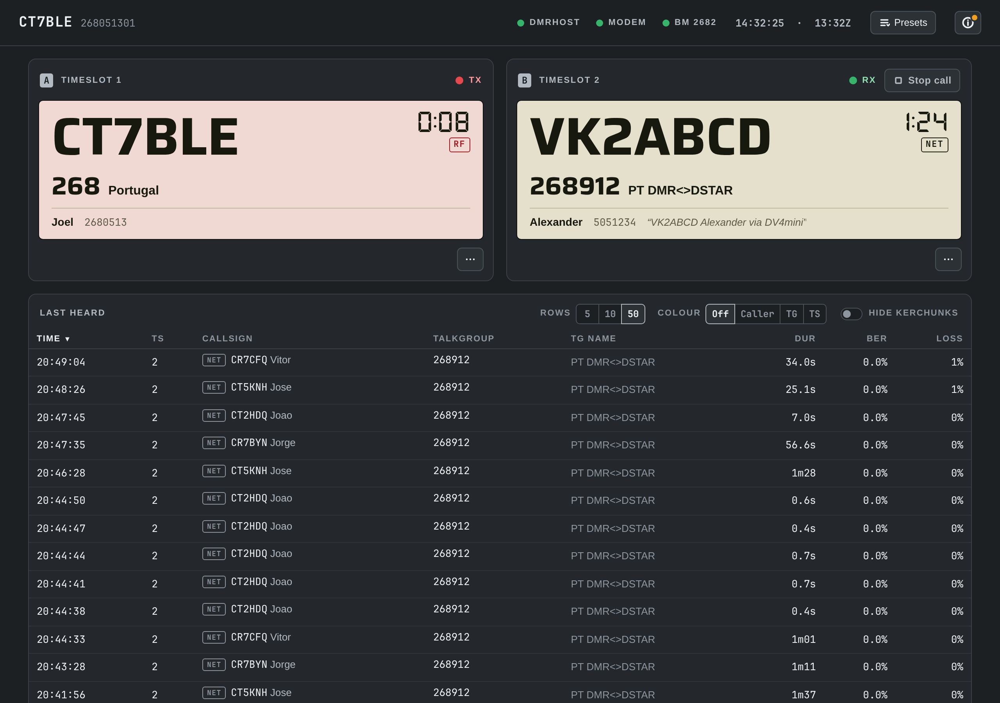
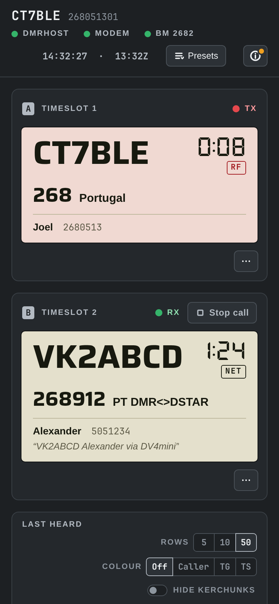

# dmrdash

A small LAN dashboard for [BrandMeister DMRHost](https://github.com/BrandMeister/DMRHost) hotspots.
It shows both timeslots live, like a dual-VFO radio. It also lets you manage your BrandMeister static
talkgroups from your phone without logging in to SelfCare.





- **Both timeslots, live:**
  - Callsign, talkgroup, name, talker alias, a TX/RX timer, and RF or network source.
  - Stop call drops the current call route.
- **Static and scheduled talkgroups:**
  - Add and remove statics per slot through the BrandMeister API, in an Edit talkgroups dialog.
  - Schedule a static TG for some days of the week and a time window (say, weekdays 18:00–20:00),
    optionally between two dates. You enter local time; BrandMeister keeps schedules in UTC, so
    they move an hour when the clocks change.
  - Edit a schedule's TG, days, times or dates. BrandMeister can't update a schedule, so the
    dashboard adds the changed one first and only then removes the old one.
  - Removal offers Undo.
  - Dynamic subscriptions are shown alongside, with Drop dynamic.
- **Presets:** save the current statics as "Everyday", "Net night"…, and switch in one tap. Only the
  difference is changed.
- **Last heard:**
  - Sort by any column, filter by callsign or talkgroup, and hide kerchunks.
  - Colour rows by caller, talkgroup or timeslot.
  - Callsigns link to QRZ.com, and talkgroups open in BrandMeister Hoseline.
- **RF BER trend:** the BER of each over from your radio, with RX offset changes marked.
- **RX offset tuning:** when your BER stays high, the dashboard suggests an offset from your recent overs.
  A tuning run steps the offset while you key up, then asks before keeping the best one.
- **RF power:** set the hotspot's transmit level to 10, 25, 50 or 100% under Modem in the Hotspot menu (the status lamp). DMRHost
  restarts with it, and the dashboard confirms once it reports the new level.
- **Restart DMRHost:** restart just the hotspot software from the Hotspot menu, for a stuck modem or BM
  login, without rebooting the Pi.
- **Master switching:** pick another BrandMeister master under BM in the Hotspot menu, or type the ID of one BrandMeister's
  list leaves out. DMRHost restarts and logs in to it, and the dashboard confirms once it has.
- **Live log:** an MMDVM-style tail of the hotspot log, kept in RAM.
- **SSH and a console:** the SSH key on the Hotspot menu's Pi row shows the `ssh` command with Copy, and opens your
  phone's SSH app. With `"shell": true`, it also opens a console in the browser: you sign in with the Pi
  account's password, as over SSH.
- **Terminal view:** `dmrdash-tui` shows both timeslots, talkgroups, last heard and the live log in a terminal,
  for when you're on the Pi over SSH. It is read-only.
- **Your layout:** drag Last heard, RF BER and Live log into the order you like, and hide any of them from the (i) menu.
  Each browser remembers its own layout.
- **Light on the Pi:**
  - Python standard library only, about 26 MB of memory, and no build step.
  - Nothing is written to the SD card in normal use. Only saving a preset, changing the RX offset or RF power, or switching master writes a small file.

<br clear="right">

## Requirements

- A Raspberry Pi (or any Linux box with systemd) running **DMRHost** as a systemd service that logs to the
  journal. MMDVMHost under systemd works too: set `"unit"` in the config.
- Python 3.9 or newer (Raspberry Pi OS Bookworm and Trixie have it).
- A BrandMeister account. To manage talkgroups you need a **SelfCare API key**.

## Install

On the Pi:

```sh
curl -fsSL https://github.com/jcalado/dmrdash/releases/latest/download/install.sh | sudo sh
```

The installer:
- downloads the latest release;
- takes your device ID from `/etc/MMDVM.ini`;
- asks for your SelfCare API key and an optional PIN;
- starts the `dmrdash` service.

Then open `http://<your-pi>.local:8080/`.

Alternatives:

- **Debian package:**
  ```sh
  sudo apt install ./dmrdash_<version>_all.deb
  ```
  Download the `.deb` from [Releases](https://github.com/jcalado/dmrdash/releases), then edit `/etc/dmrdash.conf` as below.
- **From a checkout:**
  ```sh
  git clone https://github.com/jcalado/dmrdash && cd dmrdash && sudo ./install.sh
  ```
- **A specific version:**
  ```sh
  curl -fsSL …/install.sh | sudo DMRDASH_VERSION=v1.0.0 sh
  ```

### Getting a SelfCare API key

1. Log in at [brandmeister.network](https://brandmeister.network).
2. Open **Profile settings → API Keys** and create a key.
3. Paste it when the installer asks, or put it in `/etc/dmrdash.conf` later.

Without a key the dashboard still works, in read-only mode.

The key stays on the Pi: only the dashboard's service user can read the config file, and the browser never
receives the key.

## Terminal view

```sh
dmrdash-tui                                    # on the Pi, over SSH
dmrdash-tui --url http://dmrhost.local:8080    # from another machine (needs /opt/dmrdash/tui.py, or a copy of it)
```

It needs a terminal of at least 60×16 and redraws as you resize. Keys: ↑/↓ (or j/k) select a call,
f shows only that callsign, g only that talkgroup, x or Esc clears the filter, l switches to the live log,
q quits. `--ascii` draws without box characters.

## Configuration

`/etc/dmrdash.conf` is JSON. After editing it, run `sudo systemctl restart dmrdash`.

| Setting | Default | Meaning |
|---|---|---|
| `device_id` | `0` | Your BrandMeister hotspot ID: DMR ID plus SSID, as in `[General] Id=` of `/etc/MMDVM.ini`. |
| `api_key` | `""` | SelfCare API key. Empty means read-only. |
| `pin` | `""` | When set, every change (talkgroups, presets, Stop call, RX offset, RF power, restarts, clearing events) asks for this PIN once per browser tab. |
| `port` | `8080` | HTTP port. |
| `listen` | `"0.0.0.0"` | Address to listen on. Use `"127.0.0.1"` behind a reverse proxy. |
| `unit` | `"dmrhost"` | systemd unit whose journal is followed, and which an RX offset, RF power or master change, or Restart DMRHost, restarts. |
| `mmdvm_ini` | `"/etc/MMDVM.ini"` | Hotspot config whose `[Modem] RXOffset=` the tuning helper and `[Modem] RFLevel=` the RF power helper edit, and whose `[DMR Network] Address=` the master helper edits. |
| `user_csv` | `"/usr/local/etc/user.csv"` | RadioID user file used for names. DMRHost installs it here. |
| `lastheard_size` | `50` | Calls kept in Last heard. |
| `bm_poll_seconds` | `60` | How often BrandMeister is asked for link and subscription status. |
| `allowed_hosts` | `[]` | Extra host names the dashboard answers to, e.g. a reverse-proxy name. |
| `ssh_user` | `""` | The Pi account the SSH command, the SSH app link and the console use. Empty leaves it out, and your SSH app asks. |
| `shell` | `false` | `true` turns on the console in the browser. It also needs `ssh_user`. |

## Security

dmrdash is meant for your **home LAN**. It has no user accounts.
- **Who can change talkgroups:** with an API key set, anyone who can reach the page can change your
  talkgroups. **Set a PIN** if others share your network.
- **PIN guessing:** five wrong PINs lock changes for a minute.
- **Remote access:** don't port-forward the dashboard to the internet. Use a VPN (WireGuard, Tailscale) for that.
- **Cross-site requests:** other websites can't use your browser to make changes. Changes need a custom
  header and a JSON body, and unknown `Host` names are refused (a DNS-rebinding guard).
- **Sandboxing:** the service runs as its own user, sandboxed by systemd. It can read the journal but
  can't write anywhere except its state folder (presets, and the RX offset, RF power, master and power requests).
- **RX offset changes:** the dashboard can't edit the hotspot config itself. It writes the wanted offset
  to `/var/lib/dmrdash/rxoffset.request`, and the root-run `dmrdash-rxoffset.path` and `.service` units
  pass it to `rxoffset.py`. That script accepts only a whole number within ±3000 Hz, changes only
  `RXOffset=` in the `[Modem]` section, and restarts the hotspot service. Each change cuts any call
  in progress, and like other changes it needs the PIN when one is set. To turn the feature off,
  run `sudo systemctl disable --now dmrdash-rxoffset.path`.
- **Master changes:** the same split. The dashboard writes a master ID to `/var/lib/dmrdash/master.request`,
  and the root-run `dmrdash-master.path` and `.service` units pass it to `master.py`. That script accepts only
  a four-digit ID and always writes BrandMeister's own name for it, `Address=<id>.master.brandmeister.network`,
  so the hotspot can't be pointed at a server outside BrandMeister. It changes only that line in the
  `[DMR Network]` section, and restarts the hotspot service. The PIN applies here too. To turn the feature off,
  run `sudo systemctl disable --now dmrdash-master.path`.
- **RF power changes:** the same split. The dashboard writes a percentage to `/var/lib/dmrdash/rflevel.request`,
  and the root-run `dmrdash-rflevel.path` and `.service` units pass it to `rflevel.py`. That script accepts only
  a whole number from 1 to 100 (0 would stop the hotspot transmitting), changes only `RFLevel=` in the `[Modem]`
  section, and restarts the hotspot service. The PIN applies here too. To turn the feature off,
  run `sudo systemctl disable --now dmrdash-rflevel.path`.
- **Restarts and shut down:** the same split. The Hotspot menu's Restart and Shut down keys ask for
  confirmation, then the dashboard writes `reboot`, `poweroff` or `dmrhost` to `/var/lib/dmrdash/power.request`.
  The root-run `dmrdash-power.path` and `.service` units pass it to `power.py`, which accepts only those
  three words, ignores a request older than a minute, and runs `systemctl reboot`, `systemctl poweroff`,
  or restarts the hotspot service named by `"unit"`.
  These need the PIN when one is set. To turn them off, run `sudo systemctl disable --now dmrdash-power.path`.

- **Console:** off unless `"shell": true`. It runs `ssh <ssh_user>@localhost` on the Pi and shows it in the
  browser. The Pi's own SSH server asks for the account's password and checks it, so the dashboard gains no
  rights: it stays its sandboxed user until you log in, and a Pi that only accepts SSH keys refuses. Opening one
  takes a one-time ticket through the same checks as any other change, PIN included. The connection
  must come from the dashboard's own page. At most two consoles at a time, and closing the console ends
  its session. **The password crosses your network unencrypted**, because the dashboard is plain HTTP; for
  anything sensitive, use SSH itself.

## Update and uninstall

- **Update:** run the same install command again. Your settings and presets are kept.
- **Uninstall:**
  ```sh
  curl -fsSL https://github.com/jcalado/dmrdash/releases/latest/download/install.sh | sudo sh -s -- --uninstall
  ```
  Add `--purge` to also remove `/etc/dmrdash.conf` and presets. With the Debian package, use
  `sudo apt remove dmrdash` (or `purge`).

## Troubleshooting

- **Service status:** `systemctl status dmrdash` and `journalctl -u dmrdash -n 50`.
- **Empty timeslots and log:** check that `"unit"` names the service your hotspot runs as
  (`systemctl list-units | grep -i mmdvm`). The hotspot must log to the journal.
- **"BrandMeister API unreachable":** the Pi needs internet access to `api.brandmeister.network`.
- **HTTP 401/403 from BrandMeister when changing talkgroups:** the API key is wrong or expired. Make a
  new one in SelfCare.
- **"DMRHost didn't come back with RX offset …":** check the helper with
  `systemctl status dmrdash-rxoffset.path` and `journalctl -u dmrdash-rxoffset -n 20`.
- **"The hotspot didn't come up on master …":** check `systemctl status dmrdash-master.path` and
  `journalctl -u dmrdash-master -n 20`, and that `[DMR Network] Address=` in MMDVM.ini changed.
- **"DMRHost didn't come back at …% RF power":** check `systemctl status dmrdash-rflevel.path` and
  `journalctl -u dmrdash-rflevel -n 20`, and that MMDVM.ini has an `RFLevel=` line in `[Modem]`.
- **The console says "session ended" right away:** check that `ssh_user` is a real account, that sshd is
  running and allows password logins (`PasswordAuthentication`), and `journalctl -u ssh -n 20`.
- **Restart or Shut down does nothing:** check `systemctl status dmrdash-power.path` and
  `journalctl -u dmrdash-power -n 20`.

## Development

The whole thing is `dmrdash.py` (server) and `index.html` (page, fonts inlined). Design decisions live in
[DESIGN.md](DESIGN.md), and the product brief is in [PRODUCT.md](PRODUCT.md).

```sh
python3 -m unittest discover -s tests          # server tests, no network needed
npm install --no-save playwright && npx playwright install chromium
node tests/smoke.mjs                           # page renders, PIN dialog works
packaging/build-deb.sh                         # dist/dmrdash_<version>_all.deb (needs dpkg-deb)
```

To release:
1. Bump `VERSION` in `dmrdash.py`.
2. Tag `vX.Y.Z` and push the tag.

CI then builds the tarball, `install.sh` and the `.deb`, and attaches them to a GitHub release.

## Licence

MIT, see [LICENSE](LICENSE). The two embedded font subsets (Saira and DSEG7) are under the SIL Open Font
License, see [NOTICE](NOTICE). Not affiliated with BrandMeister.
